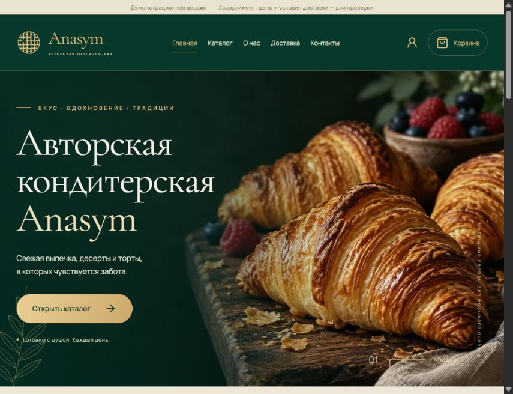

# Проверка публикации Anasym — 16 октября 2026

Опубликован отдельный проект **anasym-bakery**: https://anasym-bakery.vercel.app.
Vercel deployment `dpl_USxJKX3jHCqF4QKGFJ4XZKeFHSCF` завершился с состоянием `READY`.
Использованы Vercel CLI 64.3.1, Python 3.12, Django и новая база PostgreSQL Supabase Free `anasym-bakery-db` (Frankfurt).

## Проверено

- Production-сборка React и Python-функции успешна. Корневой requirements.txt содержит зависимости напрямую: первоначальный вариант с `-r` не прошёл сборку Vercel.
- По публичному HTTPS-адресу без Vercel-входа: `/api/health/`, `/api/settings/`, `/api/products/`, `/catalog` и `/cashier` вернули 200 с ожидаемыми типами содержимого.
- Cloud `check --deploy`, миграции, создание общего cache и первоначальное наполнение выполнены успешно.
- После защитного SQL все 17 таблиц приложения имеют RLS, роли Supabase `anon` и `authenticated` не имеют SELECT. Серверное подключение Django продолжает читать данные. Защиту следует повторять после миграций, создающих таблицы.
- Локальные проверки изменений для Vercel: 15 backend-тестов, 22 frontend-теста и 10 тестов ограничения адреса live-проверки прошли; frontend production build успешен.
- На опубликованной версии прошли **27 проверок полного сценария**: вход четырёх ролей, создание заказа, немедленная доступность администратору/кассиру/очереди курьеров, принятие курьером, все этапы доставки, учёт оплаты и повтор оплаты без дублирования. [Машиночитаемый результат](order-routing-vercel-verification-2026-10-16.json).
- В браузере проверены фотографии и каталог, кнопка «Купить», изменение количества 1 → 2, сумма 1 780 ₸, корзина с доставкой 1 500 ₸ и итогом 3 280 ₸. Переход гостя к оформлению открыл `/login?returnTo=/checkout`; корзина сохранилась. После проверки гостевая корзина очищена.

Проверочный заказ **AN-929B533B23F3**, сумма **2 390 ₸**, имеет статусы **Доставлен / Оплачен**. Он явно помечен как тестовый и остаётся в демонстрационной базе. Реальная доставка и денежная операция не выполнялись.

Первый live-прогон остановился на сетевом тайм-ауте после семи проверок. В журнале Vercel не было запроса создания заказа или серверной ошибки на этом шаге. Повторный прогон без изменений приложения прошёл все 27 шагов; в базе создан тестовый заказ с ID 1.

## Передача и ограничения

- Облачные доступы четырёх ролей: приватный `.secrets/vercel-demo-accounts.txt`. Это отдельные пароли новой среды, исключённые из Git и deployment upload.
- [Инструкция публикации, обновления и резервного копирования](vercel-deployment.md).
- `DEMO_MODE=true`: ассортимент, цены, доставка и заказы демонстрационные.
- SMTP не подключён. `PASSWORD_RESET_ENABLED=false`: восстановление через письмо честно возвращает сообщение о недоступности, не имитируя отправку.
- Домен Vercel работает по HTTPS; собственный домен не подключён. Автоматический deploy из GitHub не настраивался: опубликовано из текущего локального проекта через CLI.
- Эта проверка не заменяет отдельный прогон актуальных Firefox, Safari, Chrome и Edge. Восстановление cloud-резервной копии в этой сессии не выполнялось.

